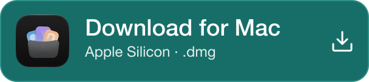
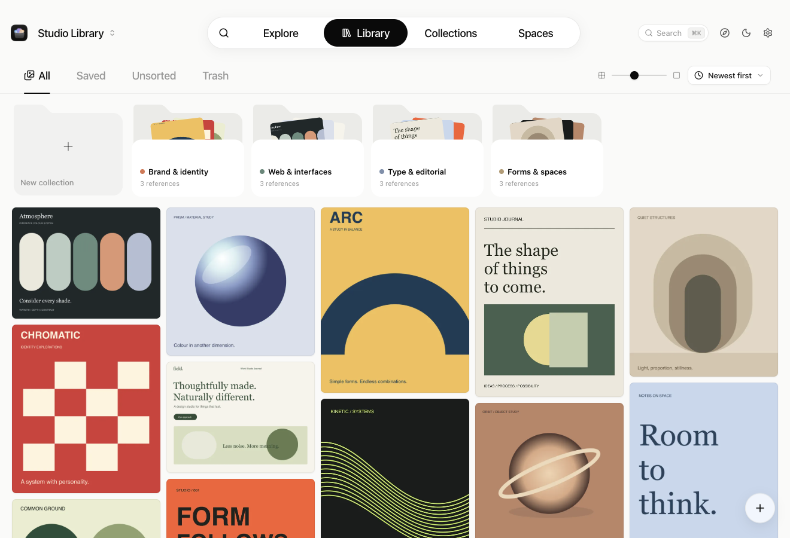
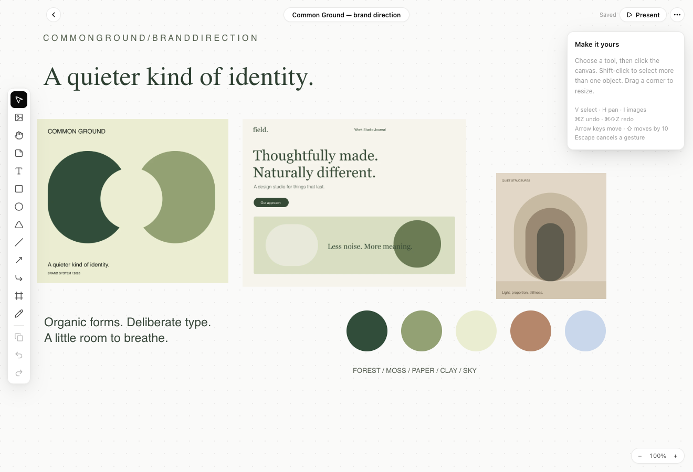
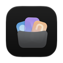

<p align="center">
  
</p>

<h1 align="center">DesignOS</h1>

<p align="center">
  <strong>Save what catches your eye. Find it when it matters.</strong><br>
  A local-first design reference library for your Mac.
</p>

<p align="center">
  Built for Apple Silicon Macs. No account required.
</p>

<p align="center">
  <a href="https://github.com/dhruv465/DesignOS/releases/latest/download/DesignOS-arm64.dmg">
    
  </a>
</p>

<p align="center">
  <a href="#install">Installation guide</a>
  &nbsp;·&nbsp;
  <a href="https://github.com/dhruv465/DesignOS/releases">All releases</a>
  &nbsp;·&nbsp;
  <a href="CHANGELOG.md">Changelog</a>
  &nbsp;·&nbsp;
  <a href="PRIVACY.md">Privacy policy</a>
</p>

<p align="center">
  
</p>

<p align="center"><sub>Real app screenshots with original demo artwork. Captured from the current source build; released versions may differ. <a href="docs/assets/README.md">Screenshot and artwork details</a>.</sub></p>

Good references deserve better than a forgotten bookmark. DesignOS brings images, videos, saved pages and visual ideas into one searchable library. Collect while you browse, organise around a project, and turn references into a direction on a canvas.

Your saved library lives on your Mac. Browsing and organising saved files works offline; web discovery and live pages use the internet.

**Website:** [DesignOS for Mac](https://dhruv465.github.io/DesignOS/)

## From inspiration to direction

| | What you can do |
| :--- | :--- |
| **Capture** | Drop in images and videos, paste from the clipboard, capture a screenshot, or save images, pages and links with the browser extension. |
| **Organise** | Build nested collections, add tags and notes, and keep separate libraries for different projects. |
| **Find** | Search titles, tags and recognised text. Narrow results by colour, collection, source or date. Enable local visual-meaning search when you need more than keywords. |
| **Compose** | Arrange references, text, shapes and drawings in **Spaces**. Present a board or export it as PNG or SVG. |
| **Explore** | Browse visual inspiration from websites you follow and keep scrolling for older posts, without a total post cap. Availability depends on public feeds, gallery APIs and page structure. |
| **Build with context** | Connect an MCP client so an AI coding tool can search your library and retrieve reference images through a read-only server. |

<p align="center">
  
</p>

<p align="center"><sub>Spaces brings your references, notes and visual direction together.</sub></p>

## Install

Download DesignOS for **Apple Silicon (arm64)**. Each link opens a file from the latest published GitHub release.

> [!IMPORTANT]
> Before upgrading to **0.6.0**, back up your library in **Settings → Data**. This release upgrades the library format for ordered media; **0.5.3 and earlier cannot open an upgraded library**. Update both the desktop app and extension. Existing split posts remain separate; re-import the original post to create a grouped reference.

| Download | Installation |
| :--- | :--- |
| <a href="https://github.com/dhruv465/DesignOS/releases/latest/download/DesignOS-arm64.dmg"></a><br>**Mac app · DMG**<br>[DesignOS-arm64.dmg](https://github.com/dhruv465/DesignOS/releases/latest/download/DesignOS-arm64.dmg) | **Recommended.** Open the disk image, drag **DesignOS** into **Applications**, then launch it from there. |
| <a href="https://github.com/dhruv465/DesignOS/releases/latest/download/DesignOS-arm64.zip"></a><br>**Mac app · ZIP**<br>[DesignOS-arm64.zip](https://github.com/dhruv465/DesignOS/releases/latest/download/DesignOS-arm64.zip) | Extract the archive, move **DesignOS.app** into **Applications**, then open it. |
| <a href="https://github.com/dhruv465/DesignOS/releases/latest/download/install.sh"></a><br>**Terminal installer**<br>[install.sh](https://github.com/dhruv465/DesignOS/releases/latest/download/install.sh) | Run the command below. The script downloads the ZIP, installs the app into Applications, clears its quarantine flag and opens it. |

> [!IMPORTANT]
> The current release is **not notarized by Apple**. After trying to open a downloaded DMG or ZIP app, go to **System Settings → Privacy & Security → Open Anyway** if macOS blocks it. The Terminal installer clears quarantine; this does not make the app notarized.

**Install with Terminal**

```sh
curl -fsSL https://github.com/dhruv465/DesignOS/releases/latest/download/install.sh | sh
```

**Previously Magpie?** Install DesignOS once using the DMG or installer. Your existing library, settings and extension pairing are reused in place. The previous app remains installed; avoid opening it after your library is upgraded. Future updates use DesignOS’s built-in updater. If you connected an AI assistant through MCP, copy the new configuration from **Settings → AI tools** so it launches DesignOS.

[Review the published installer](https://github.com/dhruv465/DesignOS/releases/latest/download/install.sh) before running it. The installer is also available for inspection in [scripts/install.sh](scripts/install.sh). On Macs without write access to `/Applications`, it uses `~/Applications`.

### Your first library

1. Open **Library** and drop in a few images, or use **⌘O** to import files.
2. Create a collection and drag references onto it.
3. Open **Search** to find references, or **Spaces** to make a board.

### Browser extension

<p>
  
  <strong>Save directly to DesignOS from your Chromium browser.</strong>
</p>

The extension works in Chrome, Brave, Edge, Arc and Dia. Update both the app and extension for the new sync, article, video and carousel features:

1. Add [DesignOS from the Chrome Web Store](https://chromewebstore.google.com/detail/designos/degmhkcaeoamggineifpdgneflgajiog).
2. In **Settings → Extension**, copy the connection code. Paste it into the extension popup and choose **Connect**.

Connect each browser once. The app and extension authenticate each other and encrypt captures over loopback; both need the paired API 2 build. Older unpaired builds cannot deliver captures to a paired app.

Right-click an image, page or link to save it. The toolbar also captures the visible page or a selected area. If DesignOS is closed, captures wait in the browser's local queue for later delivery.

Once connected, X bookmarks check every two minutes after your first visit to Bookmarks; Instagram saves check every five minutes through your signed-in browser. Sync is always on. The first successful read establishes a baseline; use the popup's **Import saves** rows for earlier saves. Choose 25, 50, 100, 200, 500 or all, and use **Stop** to end an import.

X Articles open as offline reading pages with their saved text and pictures. X and Instagram videos can save as playable MP4s, with a poster or captured frame as fallback. Carousels stay in one reference: open it and swipe or use the arrow keys to browse the slides.

Capture on Save/Bookmark is implemented for X, Instagram, Cosmos, Pinterest and LinkedIn. These integrations depend on the site's rendered page and can break when it changes; fixture tests do not establish compatibility with every live account. See [extension setup and limits](extension/README.md) and the [extension privacy policy](extension/PRIVACY.md).

### Find by text or visual meaning

Apple Vision recognises text in images and video posters on your Mac. For visual-meaning search, open **Settings → AI tools → Download model**. The optional model download is about **204 MiB**; subsequent indexing and searches run locally.

Already have a library? Use **Recognize existing text** or **Index existing images** in the same panel. See [model details and verification](docs/models.md).

### Give coding tools visual context

Open **Settings → AI tools** and copy the generated Claude Code command or MCP configuration for your client. Then try:

> Find references for a pricing page in my DesignOS library.

The bundled MCP server follows the active library and opens it read-only. Your AI client's own data-handling settings apply to references it receives. See [MCP setup](docs/mcp-setup.md).

## Your library, under your control

- **Local files and metadata.** References live in library folders, with JSON metadata and a rebuildable SQLite search index.
- **On-device processing.** Text recognition and optional visual-meaning search run locally. No DesignOS cloud account is required to use the library.
- **Explicit network features.** Web imports download source media; Explore loads website feeds or pages; link previews and live viewing contact source websites. Model downloads use Hugging Face, and update checks use GitHub.
- **Originals when you need them.** Images use optimised copies by default. Enable **Settings → Storage → Keep original files when importing** before importing if you need the original image bytes. Videos retain their originals.
- **Backups and exports.** Use **Settings → Data** to back up your library as a ZIP or rebuild its search index. Export individual references or a Space when you need to use them elsewhere.

## Keyboard shortcuts

| Action | Shortcut |
| :--- | :--- |
| Command palette | **⌘K** |
| Search | **⌘F** |
| Import files | **⌘O** |
| New collection | **⌘N** |
| Library / Collections / Spaces / Explore | **⌘1** / **⌘2** / **⌘3** / **⌘4** |
| Settings | **⌘,** |

## About this repository

This public repository contains DesignOS documentation and downloadable releases. The application source code and development history are maintained privately. GitHub’s automatic source archives contain only the public documentation.

## Updates

The installed app checks GitHub for updates at startup and once a day. When a newer release is available, an **Update to x.y.z** button appears in the top bar; click it, then **Update and Restart**. You can also use **DesignOS → Check for Updates…** or **Settings → About**. The updater replaces the app and restarts it; library data lives separately.

## Feedback

Found a bug or have a feature request? [Open an issue](https://github.com/dhruv465/DesignOS/issues). Include your macOS version, DesignOS version, steps to reproduce and what you expected. Remove private references from logs and screenshots before sharing.
